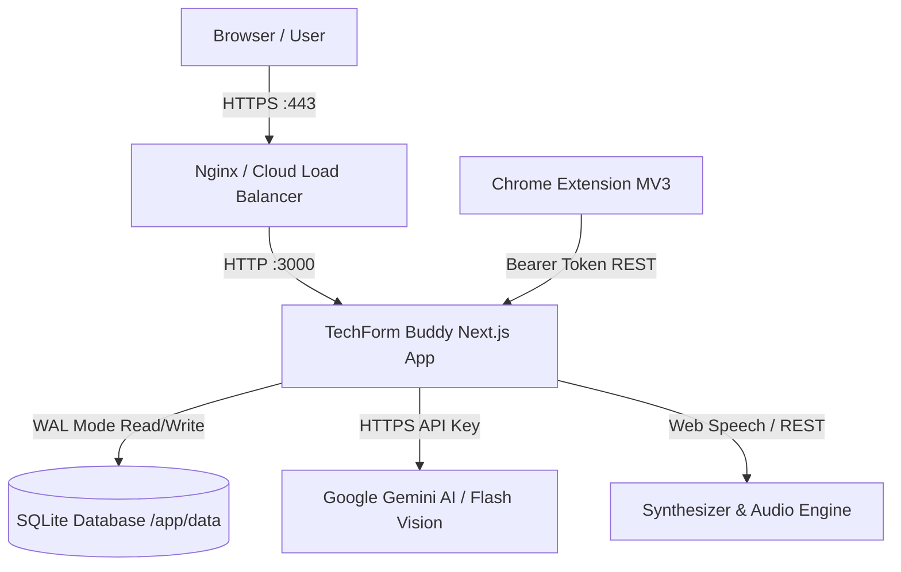

# TechForm Buddy – Production Deployment & Operations Guide

This guide covers production deployment strategies for **TechForm Buddy**, including Docker Compose, Google Cloud Run, Bare-Metal VPS (PM2/Nginx), and Chrome Extension packaging.

---

## 1. Architecture & System Overview

TechForm Buddy comprises:
1. **Next.js 16 Web Application & REST APIs** (`localhost:3000`)
2. **Persistent SQLite Database** (stored at `./data/techformbuddy.db` with WAL mode and foreign keys)
3. **Google Gemini LLM Integration** (`gemini-flash-latest` for natural language understanding and multimodal OCR)
4. **Manifest V3 Chrome Extension** (`packages/extension`) communicating with backend APIs via secure bearer tokens



---

## 2. Environment Variables

Create a production `.env` file or provide environment variables to your container:

| Variable | Required | Default | Description |
| :--- | :---: | :--- | :--- |
| `NODE_ENV` | Yes | `production` | Production environment flag |
| `PORT` | No | `3000` | Port on which Next.js listens |
| `GEMINI_API_KEY` | Recommended | `""` | Google Gemini API key for real NLU and multimodal OCR |
| `NEXTAUTH_SECRET` | Yes | - | High-entropy random secret (32+ chars) for JWT session signing |
| `NEXTAUTH_URL` | Yes | `http://localhost:3000` | Public canonical base URL of the web application |
| `VAPID_PUBLIC_KEY` | No | Auto-generated | Public key for Web Push notifications |
| `VAPID_PRIVATE_KEY`| No | Auto-generated | Private key for Web Push notifications |

---

## 3. Deployment Option 1: Docker Compose (Recommended)

Docker Compose provides a single-command setup with persistent volume management:

### 1. Build and Start Container
```bash
docker compose up -d --build
```

### 2. Verify Container Health
```bash
docker compose ps
curl http://localhost:3000/api/health
```

### 3. Check Live Logs
```bash
docker compose logs -f techformbuddy
```

### 4. Stop Container
```bash
docker compose down
```

*Note:* All citizen profiles, generated documents, and grievances are stored in the mounted `./data` directory on the host machine.

---

## 4. Deployment Option 2: Google Cloud Run (Serverless Production)

> [!IMPORTANT]
> ### Database Architecture Notice: SQLite is for Demo & Local Use Only
> The default SQLite database (`./data/techformbuddy.db`) operates in WAL mode and is designed strictly for **single-instance local testing, demo evaluations, and single-node Docker hosts**. In multi-instance serverless deployments (such as Google Cloud Run auto-scaling across 2+ containers), SQLite filesystem locks can conflict and instance recycling causes ephemeral storage loss.
>
> **Production Cloud Run deployments require a managed relational database:**
> - **Google Cloud SQL for PostgreSQL** (Recommended) or Cloud SQL for MySQL
> - **Supabase / Neon Serverless Postgres** via connection pooling (PgBouncer)

### Cloud SQL Migration Path

To migrate from SQLite to Managed Cloud SQL PostgreSQL:

#### Step 1: Provision Cloud SQL Postgres
```bash
gcloud sql instances create techformbuddy-db \
  --database-version=POSTGRES_15 \
  --tier=db-custom-2-7680 \
  --region=asia-south1 \
  --root-password="SECURE_DB_PASSWORD"

gcloud sql databases create techformbuddy --instance=techformbuddy-db
gcloud sql users create tfb_app --instance=techformbuddy-db --password="APP_USER_PASSWORD"
```

#### Step 2: Run Schema Migration & Seed
Export existing SQLite tables or execute the PostgreSQL DDL script:
```bash
# Set connection string (or use Cloud SQL Proxy on 127.0.0.1:5432)
export DATABASE_URL="postgresql://tfb_app:APP_USER_PASSWORD@/techformbuddy?host=/cloudsql/PROJECT_ID:asia-south1:techformbuddy-db"

# Execute schema creation (users, profiles, forms, grievances, applications, watches, notifications)
npm run db:migrate:postgres
```

#### Step 3: Build & Deploy Container to Cloud Run
```bash
# Build container image with Google Cloud Build
gcloud builds submit --tag gcr.io/PROJECT_ID/techformbuddy:latest .

# Deploy to Cloud Run with Cloud SQL connection
gcloud run deploy techformbuddy \
  --image gcr.io/PROJECT_ID/techformbuddy:latest \
  --platform managed \
  --region asia-south1 \
  --allow-unauthenticated \
  --port 3000 \
  --memory 2Gi \
  --cpu 2 \
  --add-cloudsql-instances PROJECT_ID:asia-south1:techformbuddy-db \
  --set-env-vars="NODE_ENV=production,NEXTAUTH_URL=https://techformbuddy.app,NEXTAUTH_SECRET=CHANGE_ME_TO_32_CHAR_SECRET,GEMINI_API_KEY=YOUR_GEMINI_KEY,DATABASE_URL=postgresql://tfb_app:APP_USER_PASSWORD@/techformbuddy?host=/cloudsql/PROJECT_ID:asia-south1:techformbuddy-db"
```

---

## 5. Deployment Option 3: VPS / Bare Metal (PM2 + Nginx)

### 1. Prerequisites
- Node.js 20+ LTS
- Build tools: `sudo apt install python3 make g++`

### 2. Build the Application
```bash
npm ci
npm run build
```

### 3. Start with PM2 Process Manager
```bash
npm install -g pm2
pm2 start npm --name "techformbuddy" -- start
pm2 save
pm2 startup
```

### 4. Nginx Reverse Proxy Configuration (`/etc/nginx/sites-available/techformbuddy`)
```nginx
server {
    listen 80;
    server_name your-domain.gov.in;

    location / {
        proxy_pass http://127.0.0.1:3000;
        proxy_http_version 1.1;
        proxy_set_header Upgrade $http_upgrade;
        proxy_set_header Connection 'upgrade';
        proxy_set_header Host $host;
        proxy_set_header X-Real-IP $remote_addr;
        proxy_set_header X-Forwarded-For $proxy_add_x_forwarded_for;
        proxy_set_header X-Forwarded-Proto $scheme;
        proxy_cache_bypass $http_upgrade;
    }
}
```

---

## 6. Chrome Extension Packaging & Deployment

To package the Chrome Extension for end users or the Chrome Web Store:

1. **Build extension bundle:**
   ```bash
   npm run build:extension
   ```
2. **Verify output:**
   The build creates self-contained bundles in `packages/extension/dist`:
   - `manifest.json` (Manifest V3)
   - `content-portal.js` (Companion mascot launcher, overlay, DOM parser)
   - `background.js` (Service worker, alarms, storage)
   - `assets/` (Icons: 16px, 48px, 128px)
3. **Load Unpacked (Development & Demo):**
   - Open Chrome or Edge: `chrome://extensions/`
   - Enable **Developer mode** (toggle in top right)
   - Click **Load unpacked** and select `packages/extension`
4. **Package for Distribution (Production):**
   - In `chrome://extensions/`, click **Pack extension** on `packages/extension`, or zip the directory contents:
   ```bash
   cd packages/extension && zip -r ../../techformbuddy-extension-v1.0.0.zip manifest.json background.js content-portal.js assets/
   ```

---

## 7. Operational Health Probes

- **JSON Health Probe:**
  `GET /api/health`
  Returns HTTP 200 with `{ status: "ok", uptimeSeconds: 124, geminiConfigured: true, database: "connected" }`.
- **Visual Status Dashboard:**
  `GET /status`
  Real-time web UI displaying connectivity status of Next.js, SQLite DB, Gemini LLM, Audio/TTS synthesizer, and Form Watch scheduler.

