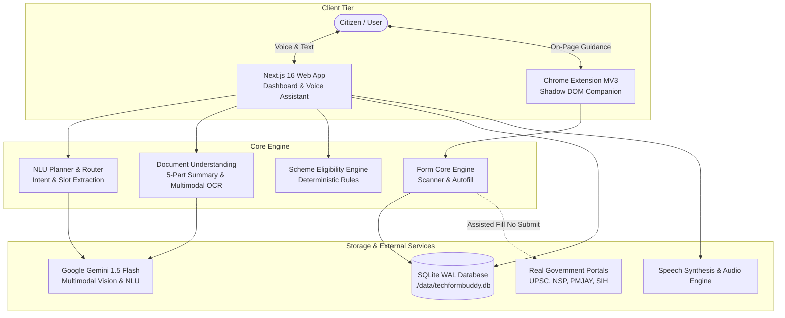
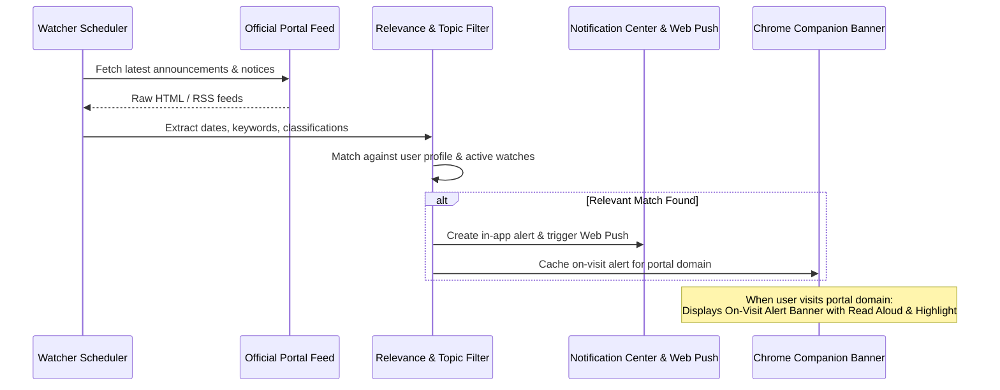

# TechForm Buddy 🇮🇳

**Multilingual AI Information, Assistance & Service Automation Platform (PS-15)**

An accessible, privacy-first AI companion and web platform designed to empower citizens to navigate, understand, and complete complex online forms and public services in their own language across desktop and mobile devices.

---

## 🏗️ System Architecture



---

## 🔒 Hard Security Rules & Design Principles

1. **Zero Auto-Submit Guarantee**: TechForm Buddy will **never** click Submit, Confirm, or Pay buttons on any external portal. The user always reviews everything and submits themselves.
2. **Zero Credential / Sensitive ID Storage**: Passwords, OTPs, captchas, and sensitive identifiers (Aadhaar, PAN, Passport, Voter ID) are excluded from automated filling and never stored or sent to AI models.
3. **Deterministic Renderers**: Documents (resumes, application forms, declarations, formal letters) are rendered with deterministic layout code. AI writes only section text—eliminating unstructured text blobs and hallucinated office addresses.
4. **No Speculative Guessing**: When confidence is low or required slots are missing, Buddy asks a clarifying question rather than guessing.
5. **No Iframe Embedding**: External government portals are never embedded in iframes or proxied; they run in clean browser tabs with the extension assistant overlay.

---

## 🌐 Background Form Watch & Proactive Alerts

TechForm Buddy includes an intelligent **Form Watch** system that monitors public portal feeds and notice boards for upcoming deadlines and new schemes:



1. **Scoped Monitoring**: Users can watch specific portals (e.g. `upsc.gov.in`, `sih.gov.in`, `scholarships.gov.in`).
2. **Relevance Filtering**: Automatically classifies notices (`registration_open`, `admit_card`, `result`, `deadline_extended`) and explains *why* a notice matched user criteria.
3. **On-Visit Alert Banner**: When a user navigates to a watched portal, the companion displays an in-context banner allowing them to read the notice aloud or highlight relevant links directly on the page.

---

## 🚀 Getting Started & Local Setup

### 1. Configure Environment Variables
Create a `.env.local` file in the project root:
```bash
# Google Gemini API Key for NLU and multimodal OCR
GEMINI_API_KEY="your-gemini-api-key-here"

# NextAuth Authentication Configuration
NEXTAUTH_SECRET="your-development-or-production-secret"
NEXTAUTH_URL="http://localhost:3000"
```

### 2. Install Dependencies
```bash
npm install
```

### 3. Build Form Core & Chrome Extension
```bash
npm run build:form-core
npm run build:extension
```

### 4. Run Next.js Local Development Server
```bash
npm run dev
```
Open [http://localhost:3000](http://localhost:3000) in your browser.

---

## 🧪 Testing

TechForm Buddy features a comprehensive automated Playwright test suite covering all core engines, endpoints, extension interactions, and voice commands:

```bash
# Run complete Playwright test suite using Microsoft Edge channel
npm run test:form-core
```

---

## 📚 Documentation & Specifications

- **[DEPLOYMENT.md](DEPLOYMENT.md)**: Production deployment instructions for Docker Compose, Google Cloud Run, PM2/Nginx, and Chrome Extension packaging.
- **[openapi.yaml](openapi.yaml)**: OpenAPI 3.0 REST API specification for developer integration.
- **[REQUIREMENTS.md](REQUIREMENTS.md)**: Master requirements matrix and empirical audit verification.
- **[DEMO.md](DEMO.md)**: 3-minute presentation script and live demonstration checklist.
- **[Dockerfile](Dockerfile)** & **[docker-compose.yml](docker-compose.yml)**: Multi-stage container build and compose orchestrations.
